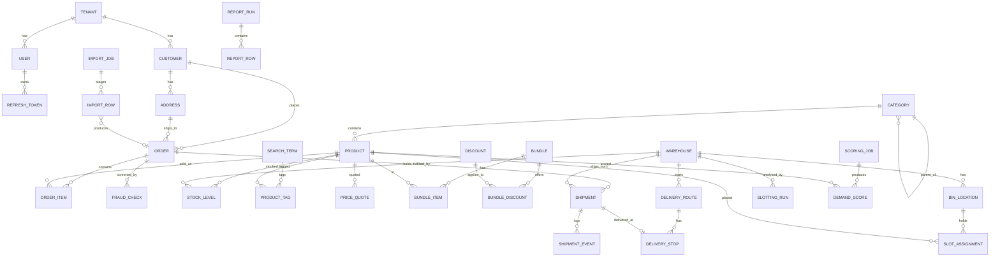

# ParcelPilot API: Database Models

Draft v0.1. Language-agnostic specification, written to be translated into SQLAlchemy 2.0 models on PostgreSQL.

Companion file: `Endpoints.md`.

---

## Conventions

- **Primary keys:** every table has `id BIGINT` (identity, auto-increment).
- **Base columns:** every table also has `created_at TIMESTAMPTZ NOT NULL DEFAULT now()`. Only extra columns are listed below.
- **Tenant scoping:** models marked *(tenant-scoped)* also have `tenant_id BIGINT NOT NULL REFERENCES tenants(id)`. Every query on these tables filters by tenant.
- **Money:** `BIGINT` minor units (`*_cents`), with a `currency CHAR(3)` where the table is not tied to a single currency elsewhere.
- **Enums:** stored as `VARCHAR` with a check constraint; values are listed in the Enums section.
- **Timestamps:** `TIMESTAMPTZ`, UTC.
- **Foreign keys:** `ON DELETE RESTRICT` unless a note says otherwise.
- **JSON:** `JSONB`.

Type shorthand: `BIGINT`, `INTEGER`, `SMALLINT`, `NUMERIC(p,s)`, `DOUBLE`, `BOOLEAN`, `VARCHAR(n)`, `TEXT`, `CHAR(n)`, `DATE`, `TIMESTAMPTZ`, `JSONB`, `INET`.

---

## Entity relationships

---

## Enums

| Enum | Values |
|------|--------|
| `TenantPlan` | `free`, `standard`, `enterprise` |
| `UserRole` | `admin`, `ops`, `analyst`, `viewer` |
| `OrderStatus` | `pending`, `fraud_review`, `confirmed`, `picking`, `shipped`, `delivered`, `cancelled` |
| `OrderSource` | `api`, `bulk_import` |
| `FraudDecision` | `allow`, `review`, `block` |
| `BlocklistEntryType` | `email`, `ip`, `address`, `name`, `phone` |
| `JobStatus` | `queued`, `running`, `completed`, `failed`, `cancelled` (`ImportJob` also allows `normalizing`) |
| `ImportFormat` | `csv`, `ndjson` |
| `ImportRowStatus` | `pending`, `imported`, `failed`, `skipped` |
| `DiscountKind` | `percent`, `fixed`, `shipping` |
| `ShipmentStatus` | `created`, `in_transit`, `out_for_delivery`, `delivered`, `exception`, `returned` |
| `ShipmentEventType` | `picked`, `packed`, `departed`, `arrived`, `out_for_delivery`, `delivered`, `exception` |
| `RouteStatus` | `draft`, `optimized`, `dispatched`, `completed` |
| `SlottingStrategy` | `frequency_proximity`, `affinity` |
| `ExportType` | `orders`, `shipments`, `stock`, `fraud_checks` |

---

## 1. Tenancy and auth

### Tenant

| Field | Type | Constraints / notes |
|-------|------|---------------------|
| `name` | VARCHAR(200) | NOT NULL |
| `slug` | VARCHAR(60) | NOT NULL, UNIQUE |
| `plan` | `TenantPlan` | NOT NULL, default `standard` |
| `is_active` | BOOLEAN | NOT NULL, default true |

### User *(tenant-scoped)*

| Field | Type | Constraints / notes |
|-------|------|---------------------|
| `email` | VARCHAR(254) | NOT NULL; UNIQUE (`tenant_id`, `email`) |
| `full_name` | VARCHAR(200) | NOT NULL |
| `password_hash` | VARCHAR(100) | NOT NULL; bcrypt hash |
| `role` | `UserRole` | NOT NULL |
| `is_active` | BOOLEAN | NOT NULL, default true |
| `last_login_at` | TIMESTAMPTZ | NULL |

### RefreshToken

| Field | Type | Constraints / notes |
|-------|------|---------------------|
| `user_id` | BIGINT | NOT NULL, FK `users.id`, ON DELETE CASCADE |
| `token_hash` | CHAR(64) | NOT NULL, UNIQUE; SHA-256 of the token |
| `expires_at` | TIMESTAMPTZ | NOT NULL |
| `revoked_at` | TIMESTAMPTZ | NULL |

---

## 2. Customers and orders

### Customer *(tenant-scoped)*

| Field | Type | Constraints / notes |
|-------|------|---------------------|
| `email` | VARCHAR(254) | NOT NULL; UNIQUE (`tenant_id`, `email`) |
| `full_name` | VARCHAR(200) | NOT NULL |
| `phone` | VARCHAR(40) | NULL |
| `external_ref` | VARCHAR(100) | NULL; UNIQUE (`tenant_id`, `external_ref`) when not null |

### Address *(tenant-scoped)*

| Field | Type | Constraints / notes |
|-------|------|---------------------|
| `customer_id` | BIGINT | NULL, FK `customers.id`; null for one-off order addresses |
| `raw_text` | TEXT | NULL; original unparsed address from imports |
| `line1` | VARCHAR(200) | NOT NULL |
| `line2` | VARCHAR(200) | NULL |
| `city` | VARCHAR(100) | NOT NULL |
| `region` | VARCHAR(100) | NULL |
| `postal_code` | VARCHAR(20) | NOT NULL |
| `country_code` | CHAR(2) | NOT NULL |
| `latitude` | DOUBLE | NULL |
| `longitude` | DOUBLE | NULL |
| `is_default` | BOOLEAN | NOT NULL, default false |
| `normalized_at` | TIMESTAMPTZ | NULL; set once cleaned and geocoded |

### Order *(tenant-scoped)*

| Field | Type | Constraints / notes |
|-------|------|---------------------|
| `customer_id` | BIGINT | NOT NULL, FK `customers.id` |
| `shipping_address_id` | BIGINT | NOT NULL, FK `addresses.id` |
| `external_ref` | VARCHAR(100) | NULL; UNIQUE (`tenant_id`, `external_ref`) when not null |
| `source` | `OrderSource` | NOT NULL, default `api` |
| `status` | `OrderStatus` | NOT NULL, default `pending` |
| `currency` | CHAR(3) | NOT NULL |
| `subtotal_cents` | BIGINT | NOT NULL |
| `discount_cents` | BIGINT | NOT NULL, default 0 |
| `tax_cents` | BIGINT | NOT NULL, default 0 |
| `shipping_cents` | BIGINT | NOT NULL, default 0 |
| `total_cents` | BIGINT | NOT NULL; `subtotal - discount + tax + shipping` |
| `fraud_decision` | `FraudDecision` | NULL |
| `fraud_score` | NUMERIC(5,2) | NULL |
| `client_ip` | INET | NULL |
| `notes` | TEXT | NULL |
| `raw_payload` | JSONB | NOT NULL; the original request or import record |
| `placed_at` | TIMESTAMPTZ | NOT NULL |
| `updated_at` | TIMESTAMPTZ | NOT NULL |

### OrderItem

| Field | Type | Constraints / notes |
|-------|------|---------------------|
| `order_id` | BIGINT | NOT NULL, FK `orders.id`, ON DELETE CASCADE |
| `product_id` | BIGINT | NOT NULL, FK `products.id` |
| `sku` | VARCHAR(64) | NOT NULL; snapshot at order time |
| `quantity` | INTEGER | NOT NULL, CHECK > 0 |
| `unit_price_cents` | BIGINT | NOT NULL |
| `discount_cents` | BIGINT | NOT NULL, default 0 |
| `tax_cents` | BIGINT | NOT NULL, default 0 |
| `line_total_cents` | BIGINT | NOT NULL; `quantity * unit_price - discount + tax` |
| `normalized` | BOOLEAN | NOT NULL, default false |

---

## 3. Bulk import

### ImportJob *(tenant-scoped)*

| Field | Type | Constraints / notes |
|-------|------|---------------------|
| `created_by` | BIGINT | NOT NULL, FK `users.id` |
| `source_filename` | VARCHAR(255) | NOT NULL |
| `format` | `ImportFormat` | NOT NULL |
| `status` | `JobStatus` or `normalizing` | NOT NULL, default `queued` |
| `dry_run` | BOOLEAN | NOT NULL, default false |
| `params` | JSONB | NOT NULL; `default_currency`, `batch_size`, normalization options |
| `total_rows` | INTEGER | NOT NULL, default 0 |
| `processed_rows` | INTEGER | NOT NULL, default 0 |
| `failed_rows` | INTEGER | NOT NULL, default 0 |
| `orders_created` | INTEGER | NOT NULL, default 0 |
| `started_at` | TIMESTAMPTZ | NULL |
| `finished_at` | TIMESTAMPTZ | NULL |
| `error_summary` | TEXT | NULL |

### ImportRow

Staging table. Expected volume: up to 2 million rows per job.

| Field | Type | Constraints / notes |
|-------|------|---------------------|
| `job_id` | BIGINT | NOT NULL, FK `import_jobs.id`, ON DELETE CASCADE |
| `row_number` | INTEGER | NOT NULL; UNIQUE (`job_id`, `row_number`) |
| `raw` | JSONB | NOT NULL; parsed source row |
| `status` | `ImportRowStatus` | NOT NULL, default `pending` |
| `error` | TEXT | NULL |
| `order_id` | BIGINT | NULL, FK `orders.id` |

---

## 4. Fraud

### BlocklistEntry

`tenant_id` is nullable: null means a global entry shared across tenants.

| Field | Type | Constraints / notes |
|-------|------|---------------------|
| `tenant_id` | BIGINT | NULL, FK `tenants.id` |
| `entry_type` | `BlocklistEntryType` | NOT NULL |
| `value` | VARCHAR(320) | NOT NULL; stored lowercase for `email`; UNIQUE (`tenant_id`, `entry_type`, `value`) |
| `reason` | VARCHAR(500) | NOT NULL |
| `source` | VARCHAR(50) | NOT NULL, default `manual` |
| `expires_at` | TIMESTAMPTZ | NULL |

### FraudCheck *(tenant-scoped)*

| Field | Type | Constraints / notes |
|-------|------|---------------------|
| `order_id` | BIGINT | NULL, FK `orders.id`; null for inline checks |
| `input_snapshot` | JSONB | NULL; payload used for inline checks |
| `score` | NUMERIC(5,2) | NOT NULL |
| `decision` | `FraudDecision` | NOT NULL |
| `matched_entry_ids` | JSONB | NOT NULL, default `[]` |
| `duration_ms` | INTEGER | NOT NULL |

---

## 5. Catalog

### Warehouse *(tenant-scoped)*

| Field | Type | Constraints / notes |
|-------|------|---------------------|
| `code` | VARCHAR(8) | NOT NULL; UNIQUE (`tenant_id`, `code`); used as the SKU-key prefix in stock lookups |
| `name` | VARCHAR(200) | NOT NULL |
| `city` | VARCHAR(100) | NOT NULL |
| `country_code` | CHAR(2) | NOT NULL |
| `latitude` | DOUBLE | NOT NULL |
| `longitude` | DOUBLE | NOT NULL |
| `is_active` | BOOLEAN | NOT NULL, default true |

### Category *(tenant-scoped)*

Adjacency list only; no materialized path.

| Field | Type | Constraints / notes |
|-------|------|---------------------|
| `parent_id` | BIGINT | NULL, FK `categories.id` (self); null for roots |
| `name` | VARCHAR(200) | NOT NULL |
| `slug` | VARCHAR(100) | NOT NULL; UNIQUE (`tenant_id`, `slug`) |
| `depth` | SMALLINT | NOT NULL; maintained on write, root = 0 |
| `sort_order` | INTEGER | NOT NULL, default 0 |

### Product *(tenant-scoped)*

| Field | Type | Constraints / notes |
|-------|------|---------------------|
| `sku` | VARCHAR(64) | NOT NULL; UNIQUE (`tenant_id`, `sku`) |
| `name` | VARCHAR(300) | NOT NULL |
| `description` | TEXT | NULL |
| `category_id` | BIGINT | NOT NULL, FK `categories.id` |
| `base_price_cents` | BIGINT | NOT NULL, CHECK >= 0 |
| `currency` | CHAR(3) | NOT NULL |
| `weight_grams` | INTEGER | NOT NULL, default 0 |
| `is_active` | BOOLEAN | NOT NULL, default true |
| `attributes` | JSONB | NOT NULL, default `{}` |

### StockLevel

| Field | Type | Constraints / notes |
|-------|------|---------------------|
| `product_id` | BIGINT | NOT NULL, FK `products.id` |
| `warehouse_id` | BIGINT | NOT NULL, FK `warehouses.id` |
| `quantity_on_hand` | INTEGER | NOT NULL, CHECK >= 0 |
| `quantity_reserved` | INTEGER | NOT NULL, default 0, CHECK >= 0 |
| `updated_at` | TIMESTAMPTZ | NOT NULL |

UNIQUE (`product_id`, `warehouse_id`). `available = quantity_on_hand - quantity_reserved`.

### SearchTerm *(tenant-scoped)*

| Field | Type | Constraints / notes |
|-------|------|---------------------|
| `term` | VARCHAR(100) | NOT NULL; UNIQUE (`tenant_id`, `term`) |
| `is_active` | BOOLEAN | NOT NULL, default true |

### ProductTag

| Field | Type | Constraints / notes |
|-------|------|---------------------|
| `product_id` | BIGINT | NOT NULL, FK `products.id`, ON DELETE CASCADE |
| `term_id` | BIGINT | NOT NULL, FK `search_terms.id`, ON DELETE CASCADE |
| `matched_at` | TIMESTAMPTZ | NOT NULL |

UNIQUE (`product_id`, `term_id`).

---

## 6. Pricing and tax

### Discount *(tenant-scoped)*

| Field | Type | Constraints / notes |
|-------|------|---------------------|
| `code` | VARCHAR(50) | NOT NULL; UNIQUE (`tenant_id`, `code`) |
| `kind` | `DiscountKind` | NOT NULL |
| `value` | BIGINT | NOT NULL; basis points for `percent`, cents otherwise |
| `min_subtotal_cents` | BIGINT | NOT NULL, default 0 |
| `stack_group` | VARCHAR(50) | NULL; discounts in the same group cannot be combined |
| `max_uses` | INTEGER | NULL |
| `used_count` | INTEGER | NOT NULL, default 0 |
| `is_active` | BOOLEAN | NOT NULL, default true |
| `valid_from` | TIMESTAMPTZ | NULL |
| `valid_to` | TIMESTAMPTZ | NULL |

### Bundle *(tenant-scoped)*

| Field | Type | Constraints / notes |
|-------|------|---------------------|
| `name` | VARCHAR(200) | NOT NULL |
| `is_active` | BOOLEAN | NOT NULL, default true |

### BundleItem

| Field | Type | Constraints / notes |
|-------|------|---------------------|
| `bundle_id` | BIGINT | NOT NULL, FK `bundles.id`, ON DELETE CASCADE |
| `product_id` | BIGINT | NOT NULL, FK `products.id` |
| `quantity` | INTEGER | NOT NULL, CHECK > 0 |

UNIQUE (`bundle_id`, `product_id`).

### BundleDiscount

Candidate discounts that may apply to a bundle.

| Field | Type | Constraints / notes |
|-------|------|---------------------|
| `bundle_id` | BIGINT | NOT NULL, FK `bundles.id`, ON DELETE CASCADE |
| `discount_id` | BIGINT | NOT NULL, FK `discounts.id`, ON DELETE CASCADE |

UNIQUE (`bundle_id`, `discount_id`).

### PriceQuote *(tenant-scoped)*

| Field | Type | Constraints / notes |
|-------|------|---------------------|
| `product_id` | BIGINT | NOT NULL, FK `products.id` |
| `customer_id` | BIGINT | NULL, FK `customers.id` |
| `quantity` | INTEGER | NOT NULL, CHECK > 0 |
| `currency` | CHAR(3) | NOT NULL |
| `discount_codes` | JSONB | NOT NULL, default `[]` |
| `unit_price_cents` | BIGINT | NOT NULL |
| `discount_cents` | BIGINT | NOT NULL, default 0 |
| `total_cents` | BIGINT | NOT NULL |
| `requested_at` | TIMESTAMPTZ | NOT NULL; client-supplied, microsecond precision |
| `expires_at` | TIMESTAMPTZ | NOT NULL |
| `cache_hit` | BOOLEAN | NOT NULL, default false |

### TaxRule *(tenant-scoped)*

| Field | Type | Constraints / notes |
|-------|------|---------------------|
| `country_code` | CHAR(2) | NOT NULL |
| `region` | VARCHAR(100) | NULL |
| `category_id` | BIGINT | NULL, FK `categories.id`; null applies to all categories |
| `rate_bps` | INTEGER | NOT NULL; 1900 = 19% |
| `threshold_cents` | BIGINT | NULL; rate applies to the amount above this threshold |
| `priority` | INTEGER | NOT NULL, default 0; higher wins when several rules match |
| `valid_from` | DATE | NOT NULL |
| `valid_to` | DATE | NULL |

---

## 7. Fulfilment and routing

### Shipment *(tenant-scoped)*

| Field | Type | Constraints / notes |
|-------|------|---------------------|
| `order_id` | BIGINT | NOT NULL, FK `orders.id` |
| `warehouse_id` | BIGINT | NOT NULL, FK `warehouses.id` |
| `carrier` | VARCHAR(50) | NOT NULL |
| `tracking_number` | VARCHAR(64) | NOT NULL; UNIQUE (`tenant_id`, `tracking_number`) |
| `status` | `ShipmentStatus` | NOT NULL, default `created` |
| `shipped_at` | TIMESTAMPTZ | NULL |
| `delivered_at` | TIMESTAMPTZ | NULL |

### ShipmentEvent

Expected volume: up to 5 million rows.

| Field | Type | Constraints / notes |
|-------|------|---------------------|
| `shipment_id` | BIGINT | NOT NULL, FK `shipments.id`, ON DELETE CASCADE |
| `event_type` | `ShipmentEventType` | NOT NULL |
| `location` | VARCHAR(100) | NULL |
| `payload` | JSONB | NOT NULL, default `{}` |
| `occurred_at` | TIMESTAMPTZ | NOT NULL |

### DeliveryRoute *(tenant-scoped)*

| Field | Type | Constraints / notes |
|-------|------|---------------------|
| `warehouse_id` | BIGINT | NOT NULL, FK `warehouses.id` |
| `route_date` | DATE | NOT NULL |
| `vehicle_label` | VARCHAR(50) | NOT NULL |
| `status` | `RouteStatus` | NOT NULL, default `draft` |
| `initial_distance_m` | INTEGER | NULL |
| `total_distance_m` | INTEGER | NULL |
| `iterations_run` | INTEGER | NULL |
| `optimized_at` | TIMESTAMPTZ | NULL |

### DeliveryStop

| Field | Type | Constraints / notes |
|-------|------|---------------------|
| `route_id` | BIGINT | NOT NULL, FK `delivery_routes.id`, ON DELETE CASCADE |
| `shipment_id` | BIGINT | NOT NULL, UNIQUE, FK `shipments.id` |
| `sequence` | INTEGER | NOT NULL; UNIQUE (`route_id`, `sequence`) |
| `latitude` | DOUBLE | NOT NULL |
| `longitude` | DOUBLE | NOT NULL |
| `eta` | TIMESTAMPTZ | NULL |
| `service_time_s` | INTEGER | NOT NULL, default 120 |

---

## 8. Warehouse slotting

### BinLocation

Expected volume: about 5000 bins per large warehouse.

| Field | Type | Constraints / notes |
|-------|------|---------------------|
| `warehouse_id` | BIGINT | NOT NULL, FK `warehouses.id` |
| `aisle` | VARCHAR(4) | NOT NULL |
| `rack` | SMALLINT | NOT NULL |
| `level` | SMALLINT | NOT NULL |
| `position` | SMALLINT | NOT NULL |
| `x_m` | NUMERIC(8,2) | NOT NULL; floor coordinates in metres |
| `y_m` | NUMERIC(8,2) | NOT NULL |
| `is_active` | BOOLEAN | NOT NULL, default true |

UNIQUE (`warehouse_id`, `aisle`, `rack`, `level`, `position`).

### SlotAssignment

| Field | Type | Constraints / notes |
|-------|------|---------------------|
| `product_id` | BIGINT | NOT NULL, FK `products.id` |
| `bin_id` | BIGINT | NOT NULL, FK `bin_locations.id` |
| `pick_frequency_30d` | INTEGER | NOT NULL, default 0 |
| `assigned_at` | TIMESTAMPTZ | NOT NULL |
| `unassigned_at` | TIMESTAMPTZ | NULL; null means current assignment |

### SlottingRun *(tenant-scoped)*

| Field | Type | Constraints / notes |
|-------|------|---------------------|
| `warehouse_id` | BIGINT | NOT NULL, FK `warehouses.id` |
| `strategy` | `SlottingStrategy` | NOT NULL |
| `lookback_days` | INTEGER | NOT NULL |
| `dry_run` | BOOLEAN | NOT NULL, default true |
| `status` | `JobStatus` | NOT NULL, default `queued` |
| `bins_considered` | INTEGER | NULL |
| `avg_pick_distance_before_m` | NUMERIC(8,2) | NULL |
| `avg_pick_distance_after_m` | NUMERIC(8,2) | NULL |
| `result` | JSONB | NULL; `moves_suggested`, `top_moves` |
| `started_at` | TIMESTAMPTZ | NULL |
| `finished_at` | TIMESTAMPTZ | NULL |

---

## 9. Scoring, analytics and reporting

### ScoringJob *(tenant-scoped)*

| Field | Type | Constraints / notes |
|-------|------|---------------------|
| `created_by` | BIGINT | NOT NULL, FK `users.id` |
| `status` | `JobStatus` | NOT NULL, default `queued` |
| `params` | JSONB | NOT NULL; horizon, lookback, product and warehouse filters |
| `workers` | SMALLINT | NOT NULL, default 4 |
| `chunk_size` | INTEGER | NULL |
| `rows_in` | BIGINT | NOT NULL, default 0 |
| `rows_out` | BIGINT | NOT NULL, default 0 |
| `started_at` | TIMESTAMPTZ | NULL |
| `finished_at` | TIMESTAMPTZ | NULL |
| `error` | TEXT | NULL |

### DemandScore *(tenant-scoped)*

| Field | Type | Constraints / notes |
|-------|------|---------------------|
| `job_id` | BIGINT | NOT NULL, FK `scoring_jobs.id`, ON DELETE CASCADE |
| `product_id` | BIGINT | NOT NULL, FK `products.id` |
| `warehouse_id` | BIGINT | NULL, FK `warehouses.id`; null = all warehouses |
| `score_date` | DATE | NOT NULL |
| `predicted_units` | NUMERIC(12,2) | NOT NULL |
| `confidence` | NUMERIC(4,3) | NOT NULL, CHECK between 0 and 1 |
| `model_version` | VARCHAR(30) | NOT NULL |

### DailySalesSummary *(tenant-scoped)*

| Field | Type | Constraints / notes |
|-------|------|---------------------|
| `summary_date` | DATE | NOT NULL |
| `currency` | CHAR(3) | NOT NULL |
| `orders_count` | INTEGER | NOT NULL |
| `items_count` | INTEGER | NOT NULL |
| `gross_cents` | BIGINT | NOT NULL |
| `discount_cents` | BIGINT | NOT NULL |
| `tax_cents` | BIGINT | NOT NULL |
| `net_cents` | BIGINT | NOT NULL |
| `computed_at` | TIMESTAMPTZ | NOT NULL |

UNIQUE (`tenant_id`, `summary_date`, `currency`).

### ReportRun *(tenant-scoped)*

| Field | Type | Constraints / notes |
|-------|------|---------------------|
| `created_by` | BIGINT | NOT NULL, FK `users.id` |
| `report_type` | VARCHAR(30) | NOT NULL; currently only `sales` |
| `params` | JSONB | NOT NULL |
| `status` | `JobStatus` | NOT NULL |
| `row_count` | INTEGER | NOT NULL, default 0 |
| `started_at` | TIMESTAMPTZ | NULL |
| `finished_at` | TIMESTAMPTZ | NULL |

### ReportRow

| Field | Type | Constraints / notes |
|-------|------|---------------------|
| `run_id` | BIGINT | NOT NULL, FK `report_runs.id`, ON DELETE CASCADE |
| `group_key` | VARCHAR(100) | NOT NULL; SKU, category id, customer id or date |
| `label` | VARCHAR(300) | NOT NULL |
| `orders_count` | INTEGER | NOT NULL |
| `units` | INTEGER | NOT NULL |
| `revenue_cents` | BIGINT | NOT NULL |
| `discount_cents` | BIGINT | NOT NULL |
| `tax_cents` | BIGINT | NOT NULL |

### MetricCounter *(tenant-scoped)*

| Field | Type | Constraints / notes |
|-------|------|---------------------|
| `name` | VARCHAR(100) | NOT NULL |
| `labels` | JSONB | NOT NULL, default `{}` |
| `labels_hash` | CHAR(32) | NOT NULL; MD5 of the canonical labels JSON |
| `value` | DOUBLE | NOT NULL, default 0 |
| `updated_at` | TIMESTAMPTZ | NOT NULL |

UNIQUE (`tenant_id`, `name`, `labels_hash`).

---

## 10. Exports

### ExportJob *(tenant-scoped)*

| Field | Type | Constraints / notes |
|-------|------|---------------------|
| `created_by` | BIGINT | NOT NULL, FK `users.id` |
| `export_type` | `ExportType` | NOT NULL |
| `params` | JSONB | NOT NULL; date range and filters |
| `status` | `JobStatus` | NOT NULL, default `queued` |
| `compressed` | BOOLEAN | NOT NULL, default true |
| `signed` | BOOLEAN | NOT NULL, default true |
| `file_path` | VARCHAR(500) | NULL |
| `size_bytes` | BIGINT | NULL |
| `sha256` | CHAR(64) | NULL |
| `hmac_signature` | VARCHAR(100) | NULL; format `hmac-sha256:<hex>` |
| `started_at` | TIMESTAMPTZ | NULL |
| `finished_at` | TIMESTAMPTZ | NULL |
| `error` | TEXT | NULL |

---

## Indexes (beyond primary keys, unique constraints and foreign keys)

| Table | Index |
|-------|-------|
| `orders` | (`tenant_id`, `status`, `placed_at`); (`customer_id`) |
| `order_items` | (`order_id`); (`product_id`) |
| `import_rows` | (`job_id`, `status`) |
| `blocklist_entries` | (`entry_type`, `value`) |
| `fraud_checks` | (`order_id`) |
| `products` | (`tenant_id`, `category_id`); (`tenant_id`, `is_active`) |
| `categories` | (`tenant_id`, `parent_id`) |
| `stock_levels` | (`warehouse_id`) |
| `product_tags` | (`term_id`) |
| `price_quotes` | (`tenant_id`, `requested_at`) |
| `tax_rules` | (`tenant_id`, `country_code`, `valid_from`) |
| `shipment_events` | (`shipment_id`, `occurred_at`) |
| `delivery_stops` | (`route_id`, `sequence`) |
| `demand_scores` | (`job_id`); (`tenant_id`, `product_id`, `score_date`) |
| `report_rows` | (`run_id`) |

---

## Test-author notes (remove before sharing with the analyzer)

**Expected data volumes**, for generating fixtures. "Hostile" is the dataset that triggers the data-dependent issues (H5, H8, P11).

| Table | Benign | Hostile / large |
|-------|--------|-----------------|
| `products` | 5,000 | 50,000 |
| `stock_levels` | 20,000 across 4 warehouses | 500,000 in 1 warehouse (all keys share one warehouse code) |
| `search_terms` | 50 | 5,000 (exceeds the `re` cache) |
| `blocklist_entries` | 1,000 | 100,000 |
| `categories` | 100, depth 3 | 5,000, depth 40 (stresses recursion) |
| `import_rows` | 10,000 per job | 2,000,000 per job |
| `shipment_events` | 50,000 | 5,000,000 |
| `bin_locations` | 500 per warehouse | 5,000 per warehouse |
| `tax_rules` | 20 | 2,000 |
| `price_quotes` | 1,000 per hour | 1,000,000 per hour (unique timestamps) |

**Model fields tied to planted issues**

- `Warehouse.code` is the prefix of the stock-lookup key (H5, P11).
- `Category.parent_id` with no materialized path forces recursive traversal (H6).
- `PriceQuote.requested_at` has microsecond precision and ends up in the cache key (H7).
- `User.password_hash` is bcrypt (P9, P10).
- `ExportJob.hmac_signature` and `compressed` drive gzip and HMAC work (P10).
- `Order.raw_payload` is the JSON that gets re-parsed between layers (H3).
